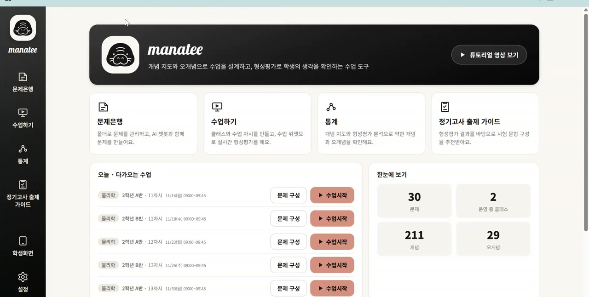
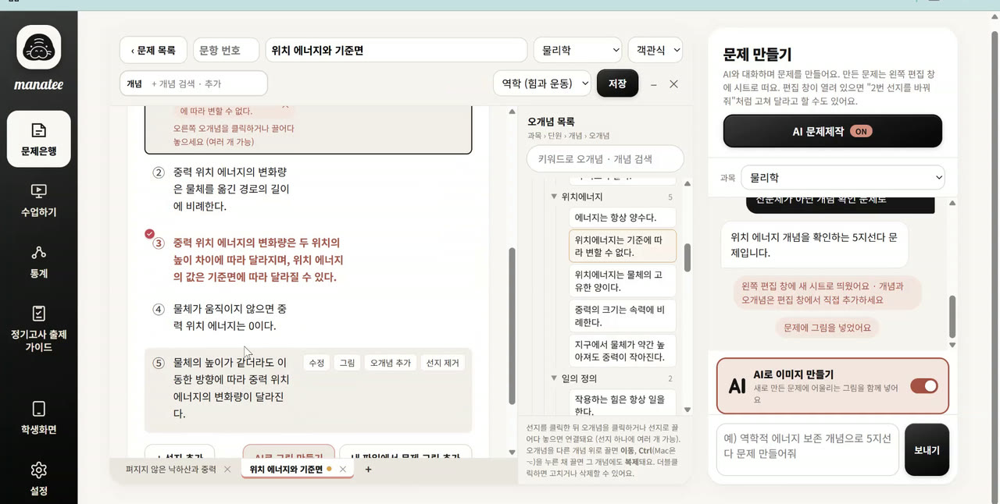
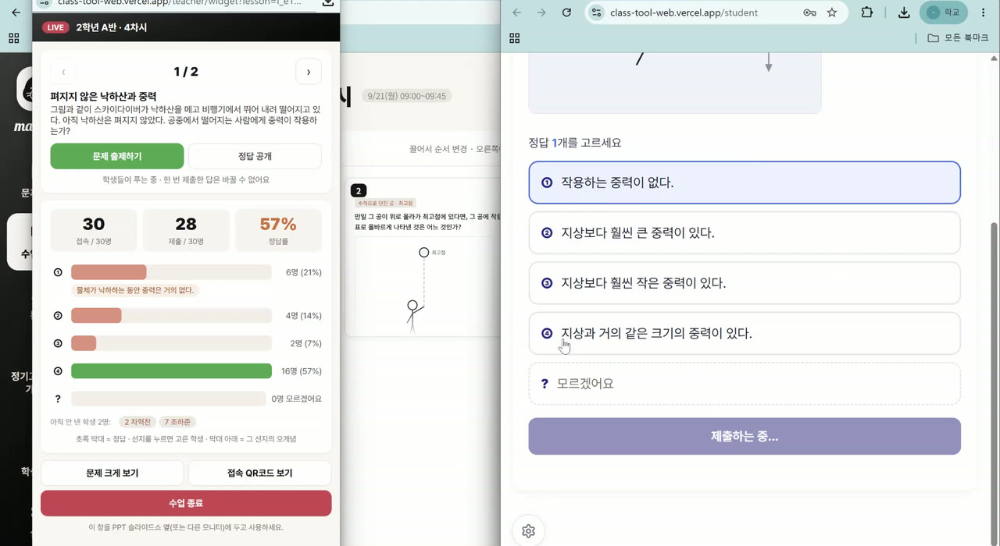
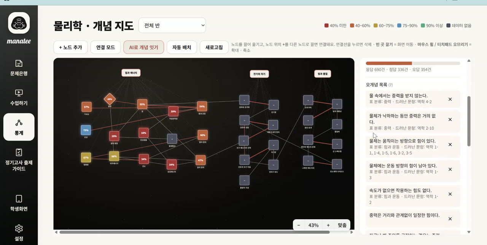
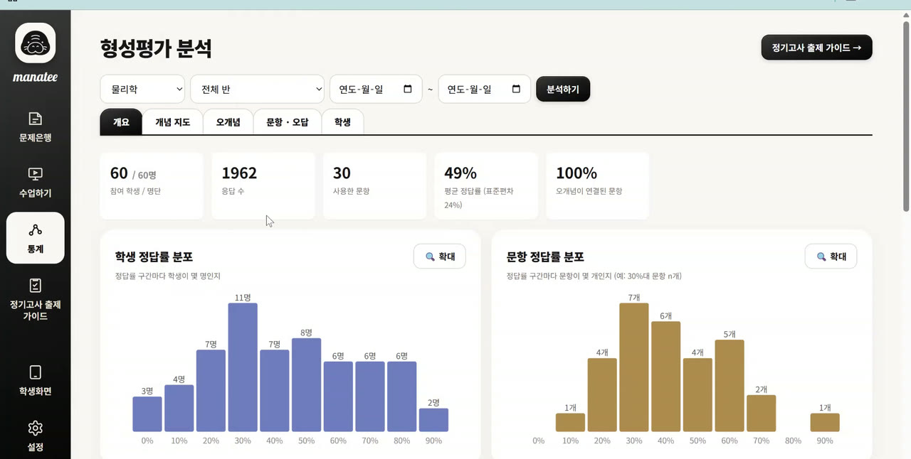
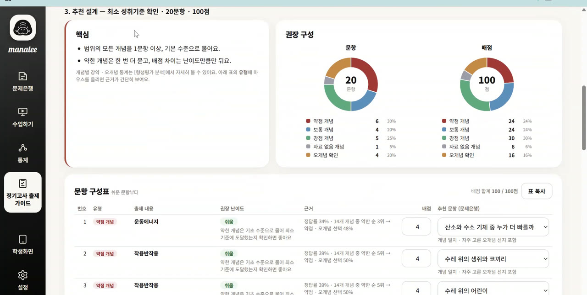

<div align="center">


# manatee — Formative Assessment to Exam Design for Science Classes

**Every answer students tap in class becomes evidence for redesigning the lesson and the next exam.**

📌 Submitted to the **SNU TEIC AIED Challenge** · Team 물개 (Mulgae), Dept. of Physics Education, Seoul National University

[Live Service](https://class-tool-web.vercel.app) · [Tutorial Video (KR)](public/video/manatee-tutorial.mp4) · [Developer Guide (KR)](DEVELOPMENT.md)

</div>

---

> **About this repository**
> This project was built and submitted to the **SNU TEIC AIED Challenge**.
> It is a copy of the team repository [yeonseo432/class-tool-web](https://github.com/yeonseo432/class-tool-web), with its commit history.
> The service targets Korean high-school science classes, so **the app UI, source comments, data, and documents are in Korean.** This README is an English overview.

> **Demo scope**
> This is a **demo version** built for the SNU TEIC AIED Challenge. Right now, only **Physics I (물리학Ⅰ)** is filled in: concepts, concept map, misconceptions, and default questions.
> Other subjects can be filled in by **applying the same approach used for Physics I**: build the concept list and concept links, link misconceptions to answer choices, and add questions.

## Motivation

1. In real classrooms, students' understanding of each **achievement standard** varies widely.
2. With limited class time, a teacher cannot check every student's understanding one by one.
3. An unmet standard is not just one missed lesson. It becomes a **barrier to the next lessons** that build on that concept.
4. It can also lead to **regular exams** whose difficulty does not match what students actually achieved or what the exam is for.
5. Without this information, lesson and exam design depend on the teacher's intuition alone.

→ Teachers need to **measure understanding during class to redesign lessons**, and to **compare learning goals with actual achievement when writing regular exams.**

## Key Features

### 📚 Question Bank
| | |
|---|---|
| AI question drafting | The teacher asks in plain language (e.g., *"a 5-option concept question on gravitational potential energy, not a calculation"*). The AI drafts the question and can generate a figure. The teacher picks the subject and can refer to the **national curriculum achievement standards** while writing. |
| Misconception-linked choices | Each wrong option is linked to a **misconception**, so a chosen option tells *which* misconception a student holds. |
| Concept tags | Each question is tagged with concepts from the subject's **concept map**. |
| Default item set | New accounts start with Physics I misconception items (with figures), concepts, and concept links. |

### 🧑‍🏫 Live Class
| | |
|---|---|
| Class roster | Teachers create classes (e.g., Class A / B). Each class gets a 4-digit **learning code**, and a printable handout gives each student an initial password. |
| Student login | Students join on a tablet with *learning code + student ID + password*, then set their own password. |
| Live widget | Start a lesson, show a **join QR code**, and project the question full-screen. Responses come in **in real time**, per option. |
| Per-option insight | Click an option to see **which students chose it** and the misconception behind it, so the teacher can adjust the lesson on the spot. Then reveal the answer to students. |
| Review for students | After class, each student can revisit the questions they got wrong. The student screen also supports several languages. |

### 📊 Statistics
- **Concept map**: each concept node is colored by its correct rate. Clicking a node shows its mastery, the misconceptions students showed, and linked questions.
- **Formative assessment analysis**: overview, concepts, concept links, misconceptions, items, and students (details below).

### 📝 Regular Exam Guide
Choose an **exam purpose**, the scope, number of items, and total points. You get a recommended blueprint:
- A composition chart (items and points)
- An item-by-item table with recommended difficulty, the evidence behind it, points, and a suggested question from the bank
- Short AI tips for writing the exam

| Purpose | Question it answers | How items are distributed |
|---|---|---|
| Minimum achievement check | *"Did everyone reach the standard?"* | Every concept in scope at least once, at a basic level (~20% misconception items) |
| Learning-gap diagnosis | *"Where and why are students stuck?"* | Concentrated on weak concepts and frequent misconceptions, easy first (~40%) |
| Norm-referenced (discrimination) | *"Who does better?"* | Fewer items on concepts the class already knows, more on medium/weak concepts and attractive distractors (~30%) |

## Screenshots

| Home | Question bank: AI drafting & misconception links |
|---|---|
|  |  |

| Live class: teacher widget & student tablet | Concept map |
|---|---|
|  |  |

| Formative assessment analysis | Regular exam guide |
|---|---|
|  |  |

## How the Statistics Work

All statistics come from in-class responses. If a student answered the same question in the same lesson more than once, only the last answer counts.
Source: [`src/server/api/analysis.ts`](src/server/api/analysis.ts).

| Level | What is computed |
|---|---|
| Item | Difficulty $p$ (correct rate); discrimination $D = p_{\text{upper 27\%}} - p_{\text{lower 27\%}}$ and point-biserial $r_{pb}$; per-option rates with flags (*attractive distractor*, *attracts high scorers*, *non-functioning*) |
| Concept | Correct rate and smoothed mastery $(c+1)/(n+2)$ so concepts with few responses do not jump to 0% or 100%; spread across students; share of students who mastered it |
| Misconception | **Selection rate** = responses choosing an option linked to it ÷ responses to items that offered it. A **z-test** against chance-level picking marks *significant* misconceptions. Wilson 95% interval on the share of students. |
| Concept link | Correct rate of linked items, and the **break rate**: students who mastered the earlier concept but not the later one |
| Student | Correct rate, weak concepts, most frequent misconceptions |

## How the Exam Recommendation Works

**Principle.** Students keep learning between formative assessment and the exam, so the guide does **not** use estimated student ability, absolute item difficulty, or a predicted score distribution. It uses only **relative** information from the formative data.

1. **Rank concepts** in scope by smoothed mastery. The bottom third is *weak*, the top third is *strong*, and the rest is *medium* (concepts with no responses are *no data*).
2. **Rank misconceptions** by selection rate. The top ones that were chosen at least twice are *frequent*.
3. **Allocate items**: a purpose-specific share goes to misconception items (one each). The rest is split across concepts by purpose weights (weak / medium / strong):
   - minimum check 2 / 1.3 / 1
   - gap diagnosis 3 / 1 / 0.3
   - norm-referenced 1.5 / 1.4 / 0.6

   Counts are rounded with the largest-remainder (Hamilton) method.
4. **Recommend difficulty** per item from the purpose and the concept's rank, with a one-line reason. For example, weak concepts are *easy* in gap diagnosis, and strong concepts are *hard* in norm-referenced exams.
5. **Assign points** mainly by difficulty (easy 1 : medium 1.35 : hard 1.75), with a small concept adjustment for norm-referenced exams. Points are re-sorted so a harder item never gets fewer points than an easier one.
6. **Order items** from easy to hard, grouping items with the same evidence.
7. **Suggest bank questions** that match the concept or the misconception. Questions whose options contain frequent misconceptions get a bonus, and questions with negative discrimination get a penalty.

## Tech Stack & Use of AI

| Area | Tools |
|---|---|
| Web app | Next.js 16 (App Router) on Vercel. The teacher screen is vanilla JS in `public/teacher-app/`. |
| Database & auth | Supabase (Postgres, Auth, Storage). Migrations are in `supabase/migrations/`. |
| Real time | Supabase Realtime broadcast, with slow polling as a fallback |
| AI | OpenAI API: question and figure drafting, misconception analysis, exam-writing tips, student-screen translation |
| Development agent | Claude Code as the main development tool |

## Project Structure

```
├── src/app/              # Pages & API routes (teacher, student, widget, login)
├── src/server/           # Server logic: teacher API, analysis & exam guide, student login/submit, OpenAI
├── public/teacher-app/   # Teacher screen (question bank, classes, concept map, analysis, exam guide)
├── supabase/migrations/  # Database schema
├── data/                 # Concept-to-concept links for the default concept map
├── scripts/              # Default item-set build, demo data, smoke tests
└── design/               # Presentation slides & script (KR)
```

See [DEVELOPMENT.md](DEVELOPMENT.md) (Korean) for setup, environment variables, and scripts.

```bash
npm install
cp .env.example .env.local   # add your Supabase and OpenAI keys
npm run dev
```

## References

| Reference | Used for |
|---|---|
| Song, J., et al. (2004). *학생의 물리 오개념 지도* [Students' Physics Misconception Map]. Seoul: Bookshill (북스힐). | Misconceptions linked to wrong answer choices, and the misconception items in the default question set |
| Visang Education (비상교육). *물리학Ⅰ* [Physics I], high-school textbook. | Concept list, unit structure, and concept links in the Physics I concept map |
| Ministry of Education (2022). *Science Curriculum* (과학과 교육과정), Notice No. 2022-33 [Annex 9], 2022 Revised National Curriculum of Korea. | Achievement standards that teachers can refer to while writing questions |

## Team 물개 (Mulgae)

박근형 · 양지운 · 차혁찬 · 최연서 — Dept. of Physics Education, Seoul National University
